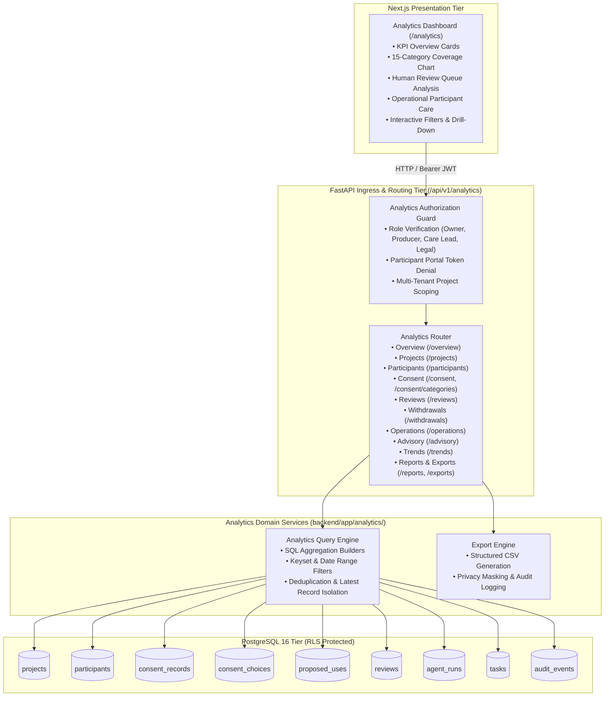

# SceneSteward — Analytics Architecture & Data Mapping

**Status:** Approved & Architectural Baseline  
**Date:** 2026-11-06  
**Authors:** Principal Software Architect, Database Architect, Analytics Lead  
**Scope:** Data Mapping, Query Architecture, Multi-Tenant Boundary, Entity Lineage  

---

## 1. System Architecture Overview

The SceneSteward Analytics Engine is a domain-native intelligence subsystem designed to extract operational insights from PostgreSQL without altering transactional invariants, weakening Row Level Security (RLS), or introducing heavy external analytical databases.

### Key Architectural Invariants:
1. **Live PostgreSQL Aggregations:** Aggregations execute directly within PostgreSQL 16 using optimized SQL expressions (`COUNT(CASE ...)`, indexed group-bys, and keyset-bounded filtering).
2. **Strict Multi-Tenant Scoping:** All queries enforce `project_id` predicates validated against the user's active `project_memberships`. Unassigned users or cross-tenant attempts receive HTTP 403 or 404.
3. **Zero Mutation of Audit History:** Analytics reads data; it never writes to `audit_events`, creates consent decisions, or triggers state transitions.
4. **Distinction of Incomplete States:**
   - Missing consent records $\neq$ approval.
   - `not_discussed` $\neq$ consent.
   - Silence is never agreement.
   - AI recommendations $\neq$ approvals.



---

## 2. Complete Data Dependency Map

| Metric Group | Metric Name | Source Table(s) | Key Columns | Business Meaning & Aggregation Logic |
|---|---|---|---|---|
| **Projects** | `total_projects` | `projects`, `project_memberships` | `id`, `status` | Count of distinct projects where requesting user has active membership. |
| **Projects** | `active_projects` | `projects` | `status = 'active'` | Count of projects in active status. |
| **Projects** | `completed_projects` | `projects` | `status = 'completed'` | Count of projects in completed lifecycle state. |
| **Participants** | `total_participants` | `participants` | `id`, `project_id`, `participant_status` | Count of registered documentary participants within authorized project scope. |
| **Participants** | `active_participants` | `participants` | `participant_status = 'active'` | Active participants whose likeness/interview is undergoing production use. |
| **Participants** | `withdrawn_participants` | `participants` | `participant_status = 'withdrawn'` | Participants who have fully revoked participation. |
| **Consent** | `discussion_coverage` | `consent_choices`, `consent_records`, `participants` | `choice`, `record_status = 'confirmed'` | Ratio of discussed categories (`agreed`, `declined`, `needs_clarification`, `explained`) to total applicable categories ($N_{\text{participants}} \times 15$). |
| **Consent** | `approval_rate` | `consent_choices`, `consent_records` | `choice = 'agreed'` | Ratio of explicitly approved choices (`agreed`) to total applicable categories ($N_{\text{participants}} \times 15$). |
| **Consent** | `resolution_rate` | `consent_choices`, `consent_records` | `choice IN ('agreed', 'declined')` | Ratio of concluded categories (`agreed` or `declined`) to total applicable categories ($N_{\text{participants}} \times 15$). |
| **Consent** | `unresolved_categories` | `consent_choices`, `consent_records` | `choice NOT IN ('agreed', 'declined')` | Total categories remaining unsettled across active roster. |
| **Reviews** | `pending_reviews` | `reviews` | `review_status = 'pending'`, `reviewer_type = 'human'` | Human review queues awaiting director/producer decision. |
| **Reviews** | `completed_reviews` | `reviews` | `review_status = 'completed'` | Reviews where human decision has been rendered. |
| **Reviews** | `turnaround_hours_avg` | `reviews` | `created_at`, `decided_at` | Average hours elapsed from review creation to human decision. |
| **Withdrawals** | `withdrawal_requests` | `audit_events`, `tasks` | `action = 'participant.withdrawal_requested'` | Count of formal participant withdrawal requests submitted. |
| **Operations** | `urgent_care_tasks` | `tasks` | `priority = 'urgent'`, `status = 'open'` | Participant care tasks requiring immediate operational intervention. |
| **Operations** | `open_care_tasks` | `tasks` | `task_type = 'participant_follow_up'`, `status IN ('open', 'in_progress')` | Unresolved inquiries or clarification follow-ups. |
| **Operations** | `overdue_tasks` | `tasks` | `due_at < NOW()`, `status != 'done'` | Tasks past their recorded due date. |
| **Advisory** | `agent_alignment_rate` | `agent_runs`, `reviews` | `output_data`, `human_decision` | Concordance between structured advisory assessment and subsequent human decision (advisory only). |

---

## 3. Latest Confirmed Consent Record Subquery Strategy

Because SceneSteward maintains an append-only, versioned record lineage (`version_number = 1, 2, ...`), aggregating consent choices requires isolating the **latest confirmed consent record** for each participant:

```sql
WITH latest_confirmed_records AS (
    SELECT DISTINCT ON (participant_id)
        id AS consent_record_id,
        participant_id,
        project_id,
        version_number
    FROM consent_records
    WHERE record_status = 'confirmed'
      AND project_id = :project_id
    ORDER BY participant_id, version_number DESC
)
SELECT 
    cc.category,
    COUNT(CASE WHEN cc.choice = 'agreed' THEN 1 END) AS agreed_count,
    COUNT(CASE WHEN cc.choice = 'declined' THEN 1 END) AS declined_count,
    COUNT(CASE WHEN cc.choice = 'needs_clarification' THEN 1 END) AS clarification_count,
    COUNT(CASE WHEN cc.choice = 'not_discussed' THEN 1 END) AS not_discussed_count,
    COUNT(CASE WHEN cc.choice = 'awaiting_confirmation' THEN 1 END) AS awaiting_confirmation_count,
    COUNT(CASE WHEN cc.choice = 'explained' THEN 1 END) AS explained_count
FROM latest_confirmed_records lcr
JOIN consent_choices cc ON cc.consent_record_id = lcr.consent_record_id
GROUP BY cc.category;
```

This subquery guarantees that superseded or draft records are never mixed into active consent coverage statistics.

