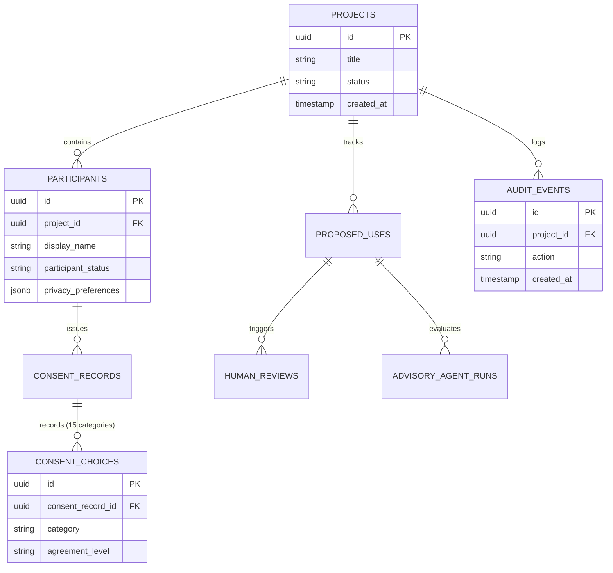

# SceneSteward — Analytics Readiness Assessment

**Document Version:** 1.0.0  
**Date:** 2026-11-06  
**Authors:** Principal Software Architect, Database Architect, Product Lead  
**Scope:** Architecture Readiness, Data Model Prerequisites, Query Strategy, and Milestone Roadmap for Analytics Module  

---

## 1. Executive Readiness Verdict

**Verdict: READY FOR ANALYTICS IMPLEMENTATION**

Following the comprehensive production hardening and security verification in PR #31, SceneSteward's underlying data model, event stream, and multi-tenant isolation foundations are completely solidified. The platform possesses the required immutable event records, categorized consent choices, and review lifecycle transitions necessary to support high-performance analytical aggregates and visual reporting without compromising tenant privacy or performance.

---

## 2. Source Data Foundations for Analytics

The upcoming Analytics module will draw from four hardened data structures:

### 2.1 Key Metrics Available for Aggregation:
1. **Consent Coverage Rate:**
   - Percentage of participants with confirmed consent records per project.
   - Breakdown across 15 canonical categories (`yes`, `no`, `ask_first`, `conditional`).
2. **Review Bottlenecks & Turnaround Times:**
   - Time elapsed from `proposed_use.submitted` to `human_review.decided`.
   - Ratio of approvals vs rejections vs `needs_participant_discussion`.
3. **Withdrawal Rate & Participant Inquiries:**
   - Frequency of `participant.clarification_requested` and `participant.withdrawal_requested`.
   - Average time to resolve follow-up participant care tasks.
4. **Agent Alignment & Disagreement Indexes:**
   - Correlation between advisory agent recommendations and ultimate human decisions.
   - Disagreement rate across agent ensemble (Legal, Ethical, Licensing, Cultural, Narrative).

---

## 3. Architectural Design Guidelines for Analytics

### 3.1 Tenant Isolation Invariants
- **Strict Project Boundary:** All analytics queries must execute with `app.user_id` set or include explicit `project_id = :project_id` predicates validated through RLS. Under no circumstances should cross-tenant aggregate metrics leak to unauthorized project members.
- **Read-Only Database Role:** Heavy analytics queries should utilize the `scenesteward_readonly` role or read-replicas in production to avoid contention with transactional write traffic.

### 3.2 Performance & Materialization Strategy
- **Materialized Views:** For high-volume projects, pre-aggregated materialized views (e.g., daily rollup tables) should be refreshed concurrently on schedule.
- **Keyset / Composite Indexing:** Ensure indices exist on `(project_id, created_at)` across `audit_events`, `human_reviews`, and `proposed_uses`.
- **Differential Privacy / Anonymization:** Participant-level analytics must aggregate statistics without exposing sensitive contact details or individual names.

---

## 4. Phase-by-Phase Analytics Implementation Roadmap

| Phase | Milestone Objective | Target Deliverables |
|---|---|---|
| **Phase 3.1** | Analytics Query Services & Aggregators | Backend SQL aggregators, repository methods for consent distribution, review turnaround metrics, and withdrawal rates. |
| **Phase 3.2** | REST API Endpoints | `/api/v1/projects/{id}/analytics/overview`, `/api/v1/projects/{id}/analytics/consent-distribution`, and `/api/v1/projects/{id}/analytics/review-metrics`. |
| **Phase 3.3** | Frontend Visualizations | Next.js interactive charts (Chart.js / SVG dashboards) displaying consent category coverage, pending human review queues, and agent alignment trends. |
| **Phase 3.4** | Export & Compliance Reporting | PDF/CSV compliance export generation for documentary film distributors, legal clearance teams, and festival submissions. |

