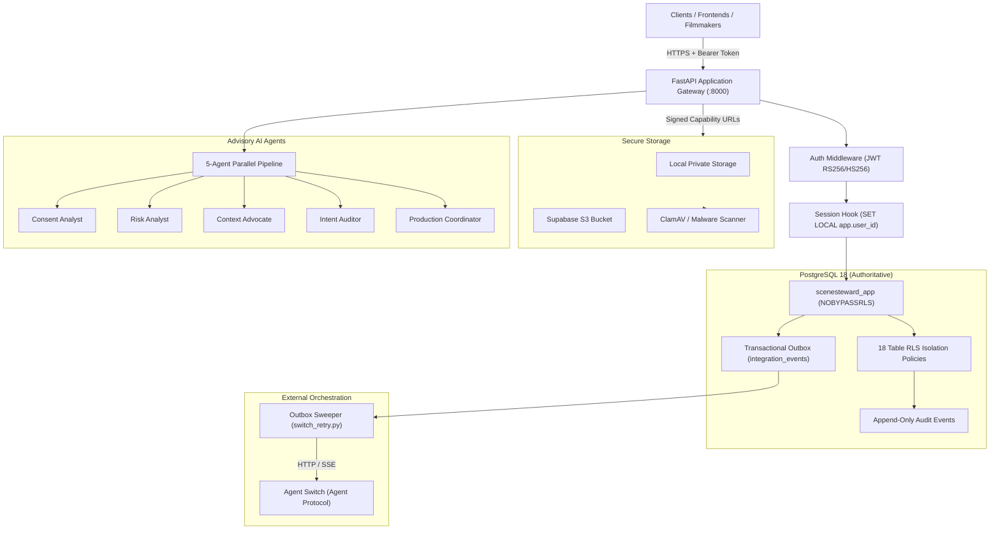

# SceneSteward Backend Architecture

## 1. System Overview

**SceneSteward** is a participant-centred documentary production workspace designed to track evolving consent, identify when new story uses require discussion, and coordinate responsible human-in-the-loop decisions through a collaborative team of human filmmakers and specialized AI agents.

### Core Ethical and Architectural Invariants
1. **Silence is never agreement**: Missing, unclear, or expired consent categories are categorized as `not_discussed` or `needs_clarification`, never assumed to be approved.
2. **PostgreSQL is the authoritative source of truth**: The database maintains strict Row Level Security (RLS), append-only audit histories, and declarative integrity constraints.
3. **AI agents are advisory**: Agents analyze, extract, challenge, and highlight uncertainty; they cannot approve participant consent or execute human decisions.
4. **Defense in depth**: Least-privilege database roles (`scenesteward_app` with `NOBYPASSRLS`), cryptographic key rings for contact details, pre-commit malware scanning, and fail-closed outbound communications.

---

## 2. Component Connection Architecture



---

## 3. Request Lifecycle and RLS Session Hook

1. **Authentication**: `CurrentUser` dependency validates JWT tokens (offline Supabase JWKS RS256/ES256 in production, HS256 dev secret in development).
2. **Context Binding**: The authenticated user ID is attached to `db.info["user_id"]`.
3. **Session Hook**: On `@event.listens_for(Session, "after_begin")`, SQLAlchemy executes:
   ```sql
   SELECT set_config('app.user_id', :user_id, true);
   ```
   Because `is_local=true`, this configuration is scoped strictly to the current transaction, preventing cross-request identity leakage when pooled connections are reused.
4. **RLS Enforcement**: Every SQL query executed by the non-owner role `scenesteward_app` is evaluated by PostgreSQL against the active project memberships of `app.user_id`.

---

## 4. Service Boundaries

| Service Boundary | Responsibility | Authoritative Data |
|---|---|---|
| **Identity & Membership** | User profiles, project roles, access validation | `users`, `project_memberships` |
| **Participant Management** | Biographical profiles, encrypted contact records, preferences | `participants`, `participant_contact_records` |
| **Document Pipeline** | Upload capabilities, malware scanning, text extraction | `release_documents`, `document_pages` |
| **Consent Management** | Versioned consent declarations, human confirmation | `consent_records`, `consent_choices` |
| **Proposed Use Workflow** | New story uses, comparison engine, human review | `proposed_uses`, `proposed_use_analyses`, `reviews` |
| **Participant Communications** | Draft messages, human approval, fail-closed delivery | `participant_communications` |
| **Audit & Observability** | Immutable event timeline, in-process & Prometheus metrics | `audit_events`, metrics collector |
| **Switch Integration** | Transactional outbox event publishing and retries | `integration_events`, `switch_room_links` |

---

## 5. Security & Isolation Controls

1. **Least-Privilege Database User**:
   - `scenesteward` (schema owner): Used strictly for Alembic migrations and test harness setup.
   - `scenesteward_app` (runtime role): `NOBYPASSRLS`, DML only (`SELECT, INSERT, UPDATE, DELETE`), granted access to public schema only.
2. **Contact Data Encryption**:
   - Multi-key Fernet key ring (`v2.<kid>.<token>`).
   - Automated online re-encryption script (`scripts/rotate_encryption_keys.py`).
   - Audit logging (`participant_contact.read`) whenever contact records are decrypted.
3. **Malware & Bomb Protection**:
   - ClamAV scanning stream integration with streaming EICAR detection.
   - Decompression bomb guard: 50 MiB uncompressed cap, 100:1 maximum compression ratio, path traversal prevention.
4. **Communication Dispatch**:
   - Human approval mandatory (`approved_by IS NOT NULL` enforced by database check constraint).
   - Fail-closed upstream dispatch (returns 503 if provider unconfigured; status never falsely advances to `sent`).

