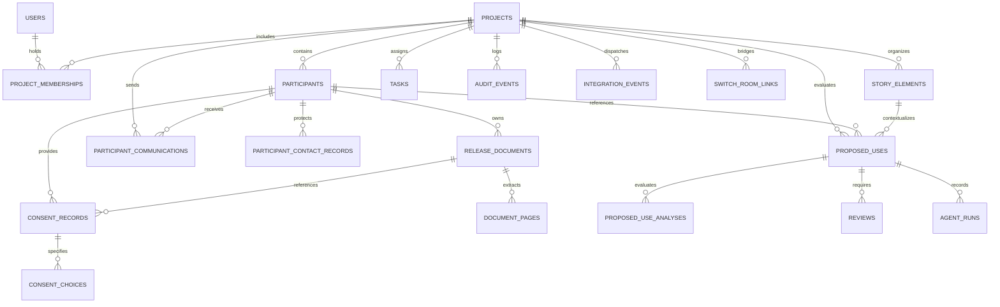

# SceneSteward Database Relationships & Schema Integrity

## 1. Entity-Relationship Overview

---

## 2. Key Integrity Constraints & Cascades

| Child Table | Foreign Key Column | Parent Table | On Delete Rule | Justification |
|---|---|---|---|---|
| `project_memberships` | `project_id` | `projects` | `CASCADE` | Memberships deleted when project deleted |
| `project_memberships` | `user_id` | `users` | `RESTRICT` | Cannot delete user with active project roles |
| `participants` | `project_id` | `projects` | `RESTRICT` | Projects with participants cannot be deleted without resolution |
| `participant_contact_records` | `participant_id` | `participants` | `CASCADE` | Contact details scrubbed when participant removed |
| `release_documents` | `participant_id` | `participants` | `RESTRICT` | Legal documentation preserved |
| `document_pages` | `document_id` | `release_documents` | `CASCADE` | Extracted pages scrubbed with parent document |
| `consent_records` | `participant_id` | `participants` | `RESTRICT` | Core consent ledger cannot be orphaned |
| `consent_choices` | `consent_record_id` | `consent_records` | `CASCADE` | Granular choices belong to specific consent version |
| `proposed_uses` | `project_id` | `projects` | `RESTRICT` | Proposals anchored to project history |
| `proposed_use_analyses` | `proposed_use_id` | `proposed_uses` | `CASCADE` | Analysis tied to the lifecycle of the proposal |
| `reviews` | `proposed_use_id` | `proposed_uses` | `RESTRICT` | Decisions preserved for audit trail |
| `agent_runs` | `proposed_use_id` | `proposed_uses` | `CASCADE` | Diagnostic runs linked to proposal |
| `participant_communications` | `project_id` | `projects` | `RESTRICT` | Outbound communication history preserved |
| `audit_events` | `project_id` | `projects` | `RESTRICT` | Tamper-evident ledger must never be cascaded away |

---

## 3. Unique Constraints

1. `uq_project_memberships_project_user`: `UNIQUE (project_id, user_id)` — A user may only hold one membership role per project.
2. `uq_consent_records_participant_version`: `UNIQUE (participant_id, version_number)` — Monotonically increasing consent version numbers per participant.
3. `uq_consent_choices_record_category`: `UNIQUE (consent_record_id, category)` — Exactly one choice per category per consent record.
4. `uq_document_pages_document_page`: `UNIQUE (document_id, page_number)` — Page ordering strictly maintained.
5. `uq_switch_room_links_room_id`: `UNIQUE (room_id)` — Switch rooms map 1:1 to SceneSteward entities.

---

## 4. Indexing & Query Optimization

- **RLS compound indexes**: `CREATE INDEX idx_project_memberships_user_project ON project_memberships(user_id, project_id, membership_status);` — Accelerates the `app_has_project_role()` function executed on every RLS query.
- **Audit indexing**: `CREATE INDEX idx_audit_events_project_created ON audit_events(project_id, created_at DESC);` — Enables fast pagination for project audit timelines.
- **Outbox polling**: `CREATE INDEX idx_integration_events_pending ON integration_events(integration_name, processing_status, attempt_count, created_at);` — Optimized for `switch_retry.py` worker batch claiming with `SKIP LOCKED`.
- **Foreign key coverage**: Every foreign key is covered by a dedicated B-tree index to eliminate sequential scans during join queries.

