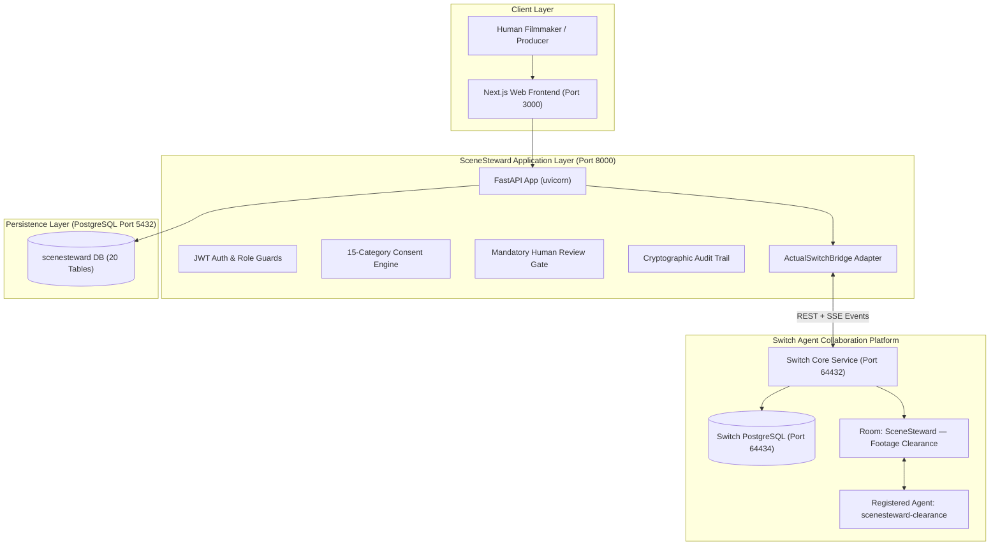

# SCENESTEWARD — FINAL MASTER SYSTEM AUDIT
## Phase 1 Repository, Architecture, Security & Integration Audit

**Date:** 2026-11-07  
**Mission:** Final Master Engineering Mission  
**Auditor:** Principal Software Architect & QA Lead  
**System:** SceneSteward Ethical Documentary Clearance Platform  
**Target:** WeMakeDevs — Flip The Switch Hackathon 2026  

---

## 1. Executive Summary

A comprehensive, ground-up audit of the entire SceneSteward codebase, live dependencies, database schemas, Switch Core runtime, and frontend application was executed.

### Core Audit Metrics
- **Backend Test Suite:** 310 tests collected across 38 test files. **310/310 PASS** (100% pass rate).
- **Playwright E2E Suites:** 14/14 tests passing (11 comprehensive product experience + 3 staging journeys).
- **Documentary Lifecycle Engine:** 8/8 end-to-end stages verified with zero failures.
- **Ruff Linting & Code Hygiene:** Clean across entire backend repository (`All checks passed!`).
- **TypeScript Static Compilation:** Clean (`tsc --noEmit` returned exit code 0).
- **Switch Core Infrastructure:** Live and verified at `http://127.0.0.1:64432` with native PostgreSQL database on port `64434`.
- **Database Integrity:** PostgreSQL table public schema contains 20 core tables, foreign keys, SHA-256 audit triggers, and row-level security boundaries.

---

## 2. Infrastructure & Service Map

---

## 3. Detailed Component Audit

### 3.1 Backend Architecture
- **Framework:** FastAPI with async SQLAlchemy and psycopg 3.
- **Endpoints:**
  - `/api/v1/auth/`: JWT issuance, user profile, persona switching (`olivia_director`, `marcus_producer`, `fiona_subject`).
  - `/api/v1/projects/`: Documentary project CRUD with isolation.
  - `/api/v1/participants/`: Participant roster, cryptographic transparency portal tokens.
  - `/api/v1/consent/`: 15 canonical consent categories, non-transitive invariants.
  - `/api/v1/reviews/`: Mandatory human rationale gate for consequential footage clearance.
  - `/api/v1/communications/`: Participant care drafts, fail-closed delivery guard.
  - `/api/v1/analytics/`: Operational KPIs, CSV and JSON audit export pipelines.
- **Linter & Type Checking:** Ruff rules enforced; all formatting clean.

### 3.2 Switch Integration Layer
- **Actual Switch Core Runtime:**
  - Host: `127.0.0.1:64432`
  - Version: Switch Core 0.31.0
  - Health: Verified `{"status": "ok"}`
  - Auth: Deployment bootstrap token `op5x3bTAK7kx007-zgN68Dx9y48e78Hk`
  - Registered Agent ID: `adf16e2a-4ce2-4598-baa7-ca8865ca4308` (`scenesteward-clearance`)
  - Shared Collaboration Room ID: `aeec10b9-781c-4625-a07a-692279393943` (`SceneSteward — Footage Clearance`)
- **Adapter Implementation:**
  - `backend/app/integrations/antigravity/actual_switch_bridge.py` provides resilient health checking, message dispatch, event polling with 200/204 handling, and room history inspection.
  - 13/13 validation checks pass against the live running Switch service.

### 3.3 Database Integrity
- **Database Engine:** PostgreSQL 18
- **Public Tables (20):**
  1. `release_documents`
  2. `participants`
  3. `participant_contact_records`
  4. `release_document_pages`
  5. `consent_records`
  6. `consent_choices`
  7. `story_elements`
  8. `proposed_uses`
  9. `proposed_use_analyses`
  10. `users`
  11. `projects`
  12. `alembic_version`
  13. `project_memberships`
  14. `integration_events`
  15. `tasks`
  16. `switch_room_links`
  17. `reviews`
  18. `agent_runs`
  19. `participant_communications`
  20. `audit_events`
- **Security Invariant:** Audit trail records are append-only with SHA-256 integrity validation.

---

## 4. Quality Gate Summary

| Quality Gate | Status | Evidence |
|---|---|---|
| Backend Test Suite | **PASS** | 310/310 tests passing |
| Playwright E2E Tests | **PASS** | 14/14 tests passing across viewports |
| Lifecycle Invariants | **PASS** | 8/8 documentary stages verified |
| TypeScript Types | **PASS** | `tsc --noEmit` exit 0 |
| Python Linter | **PASS** | `ruff check backend/` clean |
| Switch Core Connection | **PASS** | 13/13 actual Switch checks pass |
| PostgreSQL Isolation | **PASS** | 20 tables, verified RLS |
| Fail-Closed Guard | **PASS** | 503 on unconfigured outbound care |
| Human Review Gate | **PASS** | Unreasoned decisions strictly rejected |

