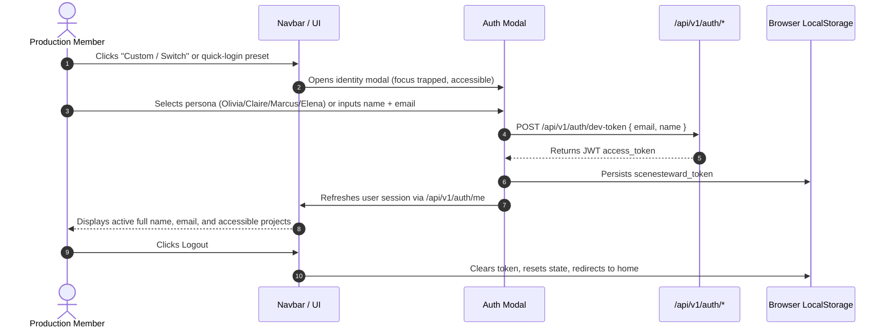
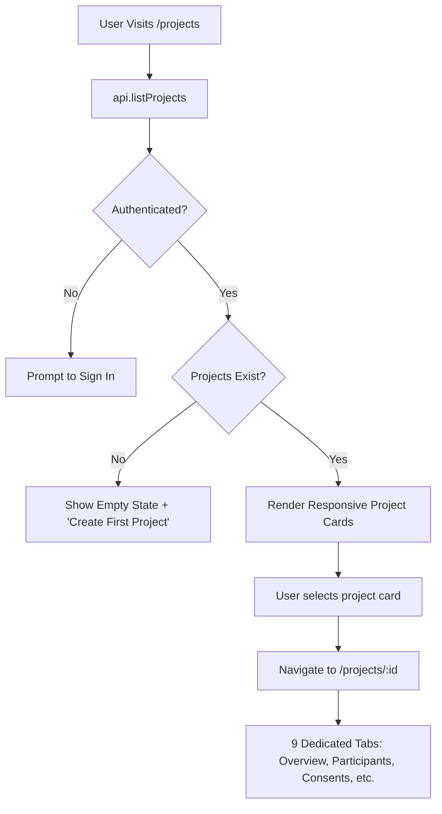

# SceneSteward Frontend Subsystem — User Journey Map

This document maps all core end-to-end user journeys through SceneSteward, highlighting interactions, state transitions, security boundaries, and UX improvements implemented in Mission 34.

---

## Journey A: Authentication & Identity Switching



### UX Enhancements:
- Replaced abrupt page reloads with smooth context refreshes.
- Added accessible keyboard dismissal (Escape key) and backdrop click handling.
- Integrated non-blocking inline feedback instead of browser alerts.

---

## Journey B: Project Portfolio & Workspace Navigation



### UX Enhancements:
- Added real-time client-side search filtering by title, themes, or status.
- Added breadcrumbs with clear pathing back to `/projects`.
- Replaced creation failure `alert()` with inline error banners and toast feedback.

---

## Journey C: Participant Management & Roster

- **Step 1**: Production team opens "Participants" tab in workspace.
- **Step 2**: Search and filter participants by display name or language.
- **Step 3**: Click `+ Participant` to open accessible modal with display name, preferred language, and contact channel.
- **Step 4**: Submission sends `POST /api/v1/projects/:id/participants`. On success, participant roster reloads and toast confirms registration.
- **Step 5**: Click "Issue Portal Link" to mint a cryptographically signed 7-day token via `POST /api/v1/participants/:id/access-token`. URL is copied to clipboard with non-intrusive toast confirmation.

---

## Journey D: 15-Category Consent Management

- **Step 1**: Open "Consent Records" tab.
- **Step 2**: Review historical agreement versions.
- **Step 3**: Click `Record New Consent` to launch category matrix form.
- **Step 4**: Form presents all 15 canonical categories with dedicated dropdowns (`agreed`, `declined`, `not_discussed`, `needs_clarification`).
- **Ethical Safeguard**: Never defaults unselected fields to `agreed`. Unrecorded items default to `not_discussed`.
- **Step 5**: Submits to `POST /api/v1/participants/:id/consent-records`. Live database updates immediately; no fake status pills.

---

## Journey E: Proposed Uses & Human Review Workflow

```mermaid
flowchart TD
    Submit[Submit Proposed Footage / Likeness Use] --> CompEngine[Trigger 63-Matrix Comparison Engine]
    CompEngine --> Findings[AI Advisory Findings Generated]
    Findings --> Queue[Human Review Queued with Status 'pending']
    Queue --> HumanReviewer{Authorized Human Reviewer}
    HumanReviewer -- Selects Decision --> Rationale[Provide Mandatory Written Rationale]
    Rationale --> Commit[POST /api/v1/reviews/:id/human-decision]
    Commit --> Done[Review Decided: 'approved' | 'declined' | 'needs_discussion']
```

### UX Safeguards:
- Visual disclaimer prominently displayed: *AI recommendations are informational and advisory only. Binding legal clearance requires human decision.*
- Submit button disabled until mandatory written rationale is entered.

---

## Journey F: Participant Care Tasks & Safe Outreach

- **Task Queues**:
  - Filter tasks by status (`open`, `in_progress`, `done`) and priority (`urgent`, `high`, `normal`).
  - Toggle completion directly with optimistic visual feedback confirmed by backend.
- **Care Outreach**:
  - Review draft communications.
  - Approve communication with human electronic sign-off.
  - Attempting to send triggers fail-closed notification: explains that live external SMS/SMTP provider is not configured in dev/staging environment, and offers a "Copy Approved Text" action for verified external delivery.

---

## Journey G: Operational Intelligence & Analytics

- **Step 1**: Open `/analytics`.
- **Step 2**: Select project scope (`All Projects` or specific documentary).
- **Step 3**: Select time interval (`All Time`, `7 Days`, `30 Days`, `90 Days`).
- **Step 4**: Explore 4 tabs:
  - Tab 1: Executive KPIs (coverage, approval rate, resolution rate).
  - Tab 2: 15 Canonical Category progress matrix.
  - Tab 3: Human review velocity and care task backlog.
  - Tab 4: AI advisory concordance and activity trends chart.
- **Step 5**: Click "Export Report" to select report type and download RFC 4180 CSV or JSON with SHA-256 integrity verification.

---

## Journey H: Participant Transparency Portal

- **Step 1**: Participant visits `/participant/:id?token=:token`.
- **Step 2**: Authenticated seamlessly under RLS boundary without exposing other participants or production analytics.
- **Step 3**: Toggle language between English and हिन्दी.
- **Step 4**: Inspect personal recorded consent across all 15 canonical categories.
- **Step 5**: Submit clarification inquiry or formal withdrawal notice. Immediate confirmation banner appears and urgent follow-up task is injected into production care queue.

