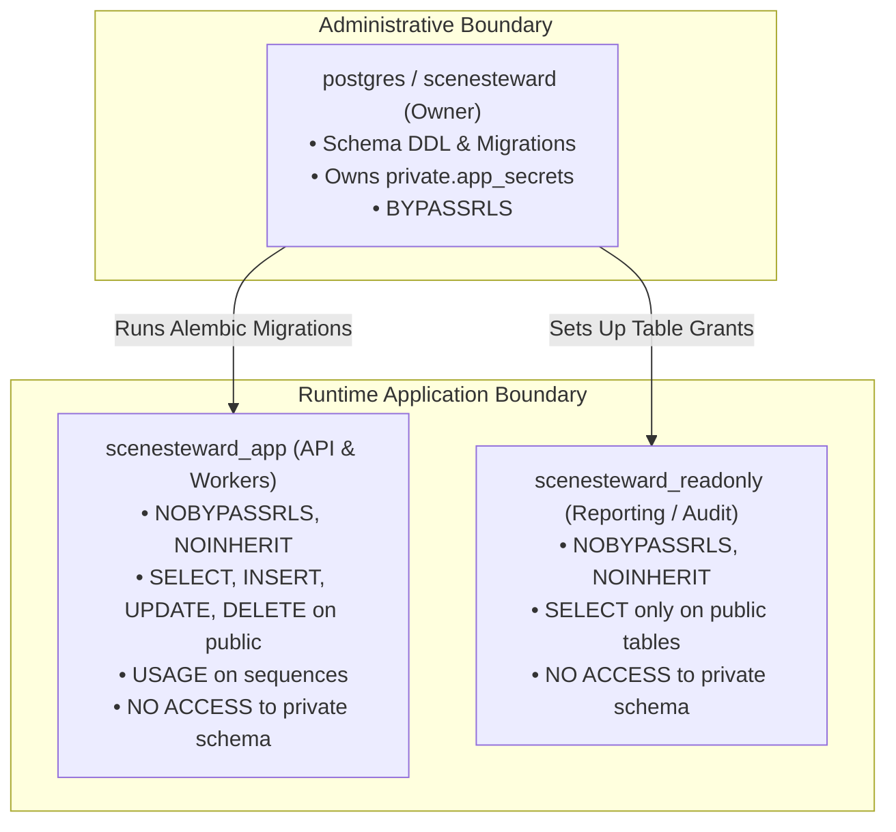

# SceneSteward — Database Security & Integrity Review

**Status:** Verified & Hardened  
**Date:** 2026-11-06  
**Auditors:** PostgreSQL Database Architect, Principal Backend Engineer  
**Scope:** PostgreSQL Schema, Least-Privilege Roles, Immutability Triggers, Cryptographic Secrets  

---

## 1. Database Role Architecture & Least Privilege

SceneSteward maintains strict separation of database privileges using dedicated PostgreSQL roles:

### Privileges Verification:
- `scenesteward_app`:
  - `has_table_privilege('scenesteward_app', 'private.app_secrets', 'select')` returns **FALSE**.
  - `has_table_privilege('scenesteward_app', 'private.app_secrets', 'insert')` returns **FALSE**.
  - Cannot bypass RLS on any public table.
- `scenesteward_readonly`:
  - `has_table_privilege('scenesteward_readonly', 'projects', 'insert')` returns **FALSE**.
  - Cannot alter data in any table.

---

## 2. Immutable Audit Trail & Consent Triggers

To satisfy strict legal and documentary integrity requirements, certain tables are guaranteed append-only via database-level triggers:

### 2.1 Audit Events Immutability
The `audit_events` table records all security-relevant decisions, consent evaluations, token generations, and outbound communications.
- **Triggers:**
  - `trg_audit_events_no_update`: Raises exception on any attempted `UPDATE`.
  - `trg_audit_events_no_delete`: Raises exception on any attempted `DELETE`.
- **Keyset Pagination:** The audit log supports deterministic keyset pagination via `(created_at, id)` to prevent pagination drift.

### 2.2 Consent Records Immutability
Once a consent record is confirmed (`status = 'confirmed'`), it becomes immutable:
- `trg_consent_records_guard`: Rejects updates to `consent_records` if the record status is already `confirmed`.
- `trg_consent_choices_guard`: Rejects updates or deletions on child `consent_choices` once parent record is confirmed.
- Any subsequent change in consent requires minting a new versioned `consent_record` (e.g., version 2), preserving the historical lineage forever.

---

## 3. Cryptographic Storage & Column Encryption

Sensitive participant contact details (phone numbers, personal emails, physical addresses) must never be stored in plaintext.
- **Fernet Symmetric Encryption:** Applied in `ParticipantContactRecord.contact_value`. Plaintext is encrypted prior to SQL insert using `encrypt_secret()` and decrypted only upon authorized access by authorized crew roles (`project_owner`, `producer`, `participant_care_lead`).
- **Key Rotation Support:** Multi-key rotation configured via `APP_ENCRYPTION_CURRENT_KID` and `APP_ENCRYPTION_KEYS` JSON map.

---

## 4. Connection Pool Safety & Clean Reset

When using pooled database connections, transaction-scoped session parameters (`app.user_id`, `app.user_sig`, `app.system`, `app.system_sig`) must be cleanly cleared between requests to prevent accidental context pollution across tenant requests:
- `set_identity(user_id, session=db)` applies `SET LOCAL app.user_id = ...` and sets session info.
- `clear_identity(session=db)` resets context.
- `system_context(session=db)` is a Python context manager guaranteeing that `app.system` is reset to `'off'` on block exit, even if an unhandled exception occurs.
- Verified in `backend/tests/security/test_production_hardening.py`.

