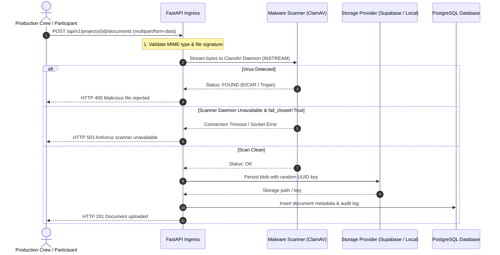

# SceneSteward — File Storage & Malware Security Review

**Status:** Verified & Hardened  
**Date:** 2026-11-06  
**Auditors:** Application Security Engineer, Cloud Infrastructure Engineer  
**Scope:** File Upload Pipeline, ClamAV Antivirus Daemon, Storage Abstraction, MIME Verification  

---

## 1. File Storage Architecture

Documentary consent management requires handling scanned signed release forms, identity documents, legal agreements, and audio/video snippets.

SceneSteward abstracts storage via `StorageProvider`:
- **Local Storage (`storage_provider="local"`):** Used in development, test, and isolated staging environments. Files are stored under dedicated directory structures with permission sanitization.
- **Supabase Storage (`storage_provider="supabase"`):** Used in production with S3-compatible signed URLs, preventing direct public access to document blobs.

---

## 2. ClamAV Malware Scanner Implementation

### 2.1 Daemon Communication (`app.services.malware_scanner`)
- Communicates with ClamAV via raw TCP socket using the ClamAV daemon `INSTREAM` protocol.
- Streams files in chunked buffers (up to 25MB max limit per document).
- Does not create temporary plaintext files on host disk before scanning.

### 2.2 Fail-Closed Security Policy
- `ANTIVIRUS_FAIL_CLOSED = True` is enforced in production.
- If the ClamAV daemon is unreachable, crashing, or timing out:
  - Any file upload attempt fails with HTTP 503 (`Antivirus scanner is unavailable`).
  - No unscanned file is ever committed to storage.
- If `ANTIVIRUS_PROVIDER = "noop"` is attempted in production, application startup lifecycle guards abort.

---

## 3. Upload Validation & Path Traversal Protections

1. **Randomized Storage Keys:** Files are never stored under their user-supplied filenames. Storage keys use `uuid4()` suffixes and project-scoped prefixes:
   `projects/{project_id}/participants/{participant_id}/{uuid4()}.{ext}`
2. **Path Traversal Guards:** File paths are validated against allowed directory roots; dot-dot (`../`) sequences and null byte injections are stripped and rejected.
3. **MIME Whitelisting:** Only allowed documentary artifacts are accepted:
   - `application/pdf`
   - `image/jpeg`
   - `image/png`
   - `image/tiff`
4. **Content-Length Verification:** Large payload DOS attacks are rejected at the ingress proxy and FastAPI streaming boundary.
