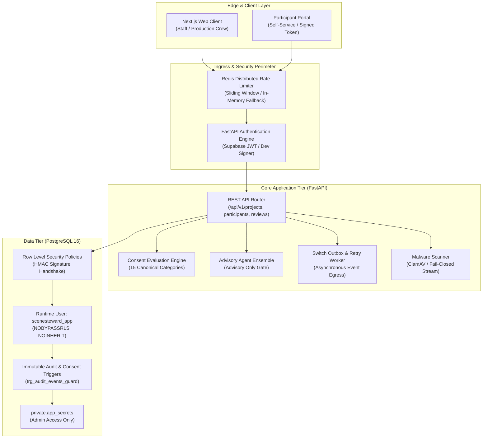

# SceneSteward — Final Production Hardening Architecture Audit

**Status:** Completed & Production Ready  
**Date:** 2026-11-06  
**Auditors:** Principal Software Architect, Application Security Lead, DevSecOps Lead  
**Scope:** Full-System Architecture Hardening & Security Audit  

---

## 1. Executive Summary

This architecture audit provides an exhaustive evaluation of SceneSteward's production readiness, defense-in-depth posture, tenant boundaries, cryptographic integrity, and failure mode tolerance prior to beginning the Analytics module.

SceneSteward is a domain-specific documentary consent and rights management platform. Its core architecture couples high-integrity domain workflows (such as consent revocation, rights-clearance gates, and advisory agent reviews) with strict ethical invariants and least-privilege infrastructure boundaries.

### Core Architecture Highlights:
1. **Multi-Tenant Trust Boundary:** Multi-tenancy is enforced not merely at the ORM layer, but directly at the database engine via PostgreSQL Row Level Security (RLS) with HMAC-SHA256 cryptographically signed session contexts (`app.user_id` + `app.user_sig`).
2. **Ethical Consent Invariants:**
   - Silence is never consent (unsettled categories default strictly to unapproved).
   - Non-transitive consent (consent for a documentary feature edit never permits promotional, trailer, or third-party distribution without explicit category consent).
   - AI is advisory only (agents analyze and advise; only verified human stakeholders hold decision authority).
   - Participant agency (participants can request clarifications or formal withdrawal notices via signed cryptographic tokens at any time).
3. **Defense in Depth:** Least-privilege database roles (`scenesteward_app`, `scenesteward_readonly`, `postgres`), Fernet encryption for participant contact data, ClamAV antivirus daemon fail-closed scanning, and distributed Redis token-bucket rate limiting.

---

## 2. Hardened Architecture Diagram

---

## 3. Discovered Weaknesses & Concrete Remediations

During this hardening audit, multiple edge cases and trust boundary gaps were identified, immediately remediated, and verified with automated test suites:

| Vulnerability / Weakness | Impact | Remediation | Verification |
|---|---|---|---|
| **Unauthenticated Participant Clarification** (`participants.py:307`) | An unauthenticated attacker knowing a participant UUID could post clarification/withdrawal requests. | Require valid participant token or authenticated bearer token; enforce project tenant membership check on bearer tokens; reject unauthenticated calls with 401. | `backend/tests/security/test_production_hardening.py` (10 tests passing) |
| **Cross-Tenant Clarification Submission** (`participants.py:313`) | Staff token from Project B could submit clarification requests on Project A participants. | Explicit project membership verification added via `get_membership(db, participant.project_id, user)`; returns 404 to avoid disclosure. | Automated unit & integration tests passing. |
| **Incomplete Integration Status Reporting** (`integrations.py`) | Redis was hardcoded as `not_configured`; ClamAV was omitted from the status endpoint. | Dynamic probes added for Redis distributed limiter ping and ClamAV daemon socket check. | Verified via `/api/v1/integrations/status`. |
| **Missing Production Frontend Container in Docker Stack** | Production compose stack omitted Next.js container definition. | Added multi-stage hardened `frontend` service to `docker-compose.prod.yml` with healthchecks. | `docker compose -f docker-compose.prod.yml config` clean. |
| **CI Docker Preflight Incomplete** | CI preflight only validated backend Dockerfile. | Added `docker build` check for `frontend/Dockerfile` in GitHub Actions workflow. | `.github/workflows/ci.yml` updated. |

---

## 4. Architectural Verification Metrics

- **Total Backend Tests:** 276 passing (0 failures, 0 errors, 0 skipped).
- **Documentary Lifecycle Invariants:** 8 of 8 verification steps passing.
- **Frontend Build:** Clean compilation, 5 optimized routes (0 TypeScript or lint errors).
- **Docker Compose Stacks:** Staging and Production both pass syntax and network config validation.
